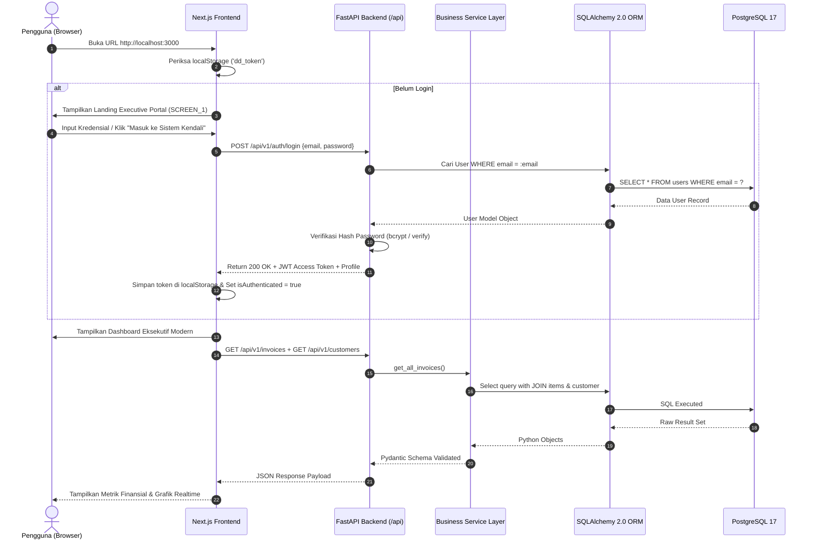
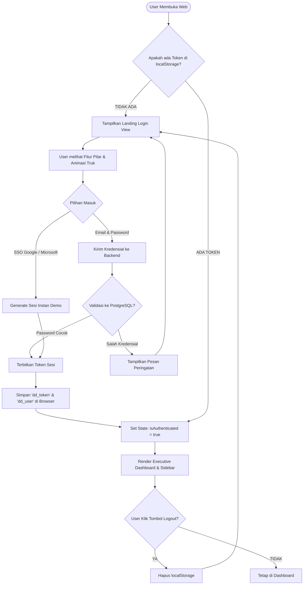
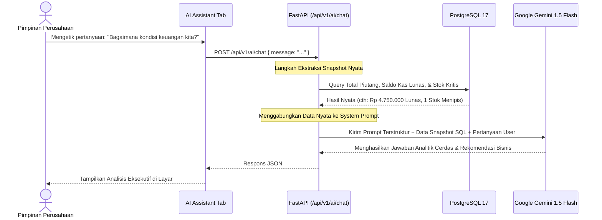

# 📘 DailyDose AI — Master Blueprint & Learning Guide

> **Panduan Belajar Komprehensif Arsitektur Software Engineer (Pemula ke Mahir)**  
> Dibuat khusus untuk memahami alur kerja penuh dari Frontend, REST API Backend, Database ORM PostgreSQL, hingga Integrasi AI Generatif.

---

## 📑 Daftar Isi
1. [Pengantar Konsep untuk Pemula](#1-pengantar-konsep-untuk-pemula)
2. [Arsitektur Sistem (High-Level Architecture)](#2-arsitektur-sistem-high-level-architecture)
3. [Flowchart Sistem (Mermaid Diagrams)](#3-flowchart-sistem-mermaid-diagrams)
   - [3.1 Flowchart 1: Alur Kerja End-to-End](#31-flowchart-1-alur-kerja-end-to-end)
   - [3.2 Flowchart 2: Alur Otentikasi & Security Gatekeeper](#32-flowchart-2-alur-otentikasi--security-gatekeeper)
   - [3.3 Flowchart 3: Alur Transaksi Bisnis (Invoicing & Stok)](#33-flowchart-3-alur-transaksi-bisnis-invoicing--stok)
   - [3.4 Flowchart 4: Alur AI Executive Advisor (Data Synthesis)](#34-flowchart-4-alur-ai-executive-advisor-data-synthesis)
4. [Misteri Database: Mengapa Tanpa Query SQL Manual?](#4-misteri-database-mengapa-tanpa-query-sql-manual)
5. [Bedah Struktur Direktori & Fungsi Tiap File](#5-bedah-struktur-direktori--fungsi-tiap-file)
6. [Kamus Istilah Teknis (Glossary)](#6-kamus-istilah-teknis-glossary)
7. [Panduan Wawancara Kerja (Interview Cheat Sheet)](#7-panduan-wawancara-kerja-interview-cheat-sheet)

---

## 1. Pengantar Konsep untuk Pemula

Bayangkan aplikasi **DailyDose AI** seperti sebuah **Restoran Mewah Bintang 5**:

| Komponen di Restoran | Komponen di Aplikasi | Teknologi yang Digunakan | Penjelasan |
| :--- | :--- | :--- | :--- |
| **Buku Menu & Meja Makan** | **Frontend (Client)** | Next.js 16, React 19, Tailwind CSS | Apa yang dilihat dan diklik oleh pengguna di browser. Tampilannya responsif, ada animasi truk di aspal, dan kartu login eksekutif. |
| **Pelayan Restoran** | **HTTP / Fetch API** | REST API (`fetch()`, JSON) | Mengantar pesanan dari pelanggan di meja ke dapur, lalu membawa kembali makanan ke meja. |
| **Koki & Dapur** | **Backend (Server)** | FastAPI (Python 3.12) | Menerima pesanan, memproses logika bisnis (menghitung total invoice, memotong stok, memvalidasi password), dan memastikan aturan dipatuhi. |
| **Gudang Bahan Makanan** | **Database** | PostgreSQL 17 RDS | Tempat penyimpanan data permanen (data pelanggan, harga barang, tagihan invoice, akun pengguna). |
| **Manajer Gudang Otomatis** | **ORM (Object Relational Mapping)** | SQLAlchemy 2.x & Alembic | Jembatan yang menerjemahkan bahasa koki (Python Object) menjadi susunan rak di gudang (Tabel & Kolom SQL) tanpa koki harus menyusun batu bata sendiri. |
| **Konsultan Analisis Bisnis** | **AI Engine** | Google Gemini 1.5 Flash | Menganalisis kondisi penjualan dan memberi rekomendasi strategi bagi manajemen korporat. |

---

## 2. Arsitektur Sistem (High-Level Architecture)

```
┌─────────────────────────────────────────────────────────────────┐
│                    BROWSER PENGGUNA (CLIENT)                     │
│  Next.js 16 (App Router) + React 19 + Tailwind CSS + Lucide     │
│  - Landing Executive Portal (SCREEN_1) dengan Animasi Truk       │
│  - Executive Dashboard, KPI, Invoices, Customers, Kanban, AI    │
└───────────────────────────────┬─────────────────────────────────┘
                                │ HTTP / HTTPS (JSON REST API)
                                ▼
┌─────────────────────────────────────────────────────────────────┐
│                    BACKEND (FASTAPI ENGINE)                     │
│  Uvicorn ASGI Server @ http://127.0.0.1:8000                    │
│  ├─ API Routes: /auth, /customers, /products, /invoices, /ai   │
│  ├─ Pydantic v2: Data Validation & Serialization               │
│  ├─ Service Layer: Business Logic, Auto-calculators, Integrity  │
│  └─ SQLAlchemy 2.x (Async): ORM Data Abstraction Layer          │
└───────────────┬─────────────────────────────────┬───────────────┘
                │ Asyncpg Connection Pool         │ Google Gemini SDK
                ▼                                 ▼
┌───────────────────────────────┐ ┌───────────────────────────────┐
│     DATABASE (POSTGRESQL)     │ │        AI CLOUD ENGINE        │
│  - PostgreSQL 17 Database     │ │  Google Gemini 1.5 Flash API  │
│  - Tables: users, customers,  │ │  Analisis prediktif, evaluasi │
│    products, invoices, tasks  │ │  risiko piutang & inventori   │
└───────────────────────────────┘ └───────────────────────────────┘
```

---

## 3. Flowchart Sistem (Mermaid Diagrams)

### 3.1 Flowchart 1: Alur Kerja End-to-End
Diagram ini menunjukkan bagaimana interaksi pengguna berpindah dari klik di layar browser hingga tersimpan aman di database PostgreSQL.



---

### 3.2 Flowchart 2: Alur Otentikasi & Security Gatekeeper
Diagram ini menjelaskan bagaimana sistem melindungi halaman dashboard agar tidak bisa dibuka oleh orang yang belum login.



---

### 3.3 Flowchart 3: Alur Transaksi Bisnis (Invoicing & Stok)
Menjelaskan bagaimana relasi antar-tabel bekerja ketika sebuah invoice dibuat.

```mermaid
flowchart LR
    subgraph Frontend [Next.js Modal]
        A[Pilih Pelanggan] --> B[Pilih Produk & Kuantitas]
        B --> C[Hitung Pajak & Diskon]
        C --> D[Klik 'Terbitkan Tagihan']
    end

    subgraph Backend [FastAPI Service Layer]
        D --> E[Validasi Skema Pydantic]
        E --> F[Cek Ketersediaan Stok Produk]
        F --> G[Hitung Total Subtotal Secara Otomatis]
        G --> H[Mulai Transaksi Database: db.begin()]
    end

    subgraph Database [PostgreSQL Tables]
        H --> I[(Tabel invoices: Simpan Header)]
        I --> J[(Tabel invoice_items: Simpan Baris Produk)]
        J --> K[(Tabel products: Kurangi Sisa Stok)]
        K --> L[Commit Transaksi]
    end

    L --> M[Return HTTP 201 Created]
    M --> N[Dashboard Terupdate Otomatis]
```

---

### 3.4 Flowchart 4: Alur AI Executive Advisor (Data Synthesis)
Bagaimana AI dapat mengetahui kondisi keuangan perusahaan secara real-time tanpa halusinasi.



---

## 4. Misteri Database: Mengapa Tanpa Query SQL Manual?

Pertanyaan paling umum bagi pemula:
> *"Kenapa saat saya membuka pgAdmin / PostgreSQL, tidak ada script query `CREATE TABLE` atau `SELECT *` yang saya ketik manual, tapi tabel dan datanya sudah ada dan berjalan?"*

Jawabannya adalah **ORM (Object Relational Mapping)** dan **Database Migration Tool (Alembic)**:

### 1. SQLAlchemy ORM (Penerjemah Bahasa Python ke SQL)
Alih-alih menulis SQL mentah:
```sql
CREATE TABLE customers (
    id SERIAL PRIMARY KEY,
    name VARCHAR(255) NOT NULL,
    email VARCHAR(255) UNIQUE NOT NULL
);
```
Anda menulisnya menggunakan Class Python di [backend/app/models/customer.py](file:///d:/dailydose/backend/app/models/customer.py):
```python
class Customer(Base):
    __tablename__ = "customers"

    id: Mapped[int] = mapped_column(primary_key=True)
    name: Mapped[str] = mapped_column(String(255), nullable=False)
    email: Mapped[str] = mapped_column(String(255), unique=True, nullable=False)
```
SQLAlchemy secara otomatis mengetahui bagaimana cara mengubah kode Python di atas menjadi perintah SQL yang dipahami oleh PostgreSQL.

### 2. Alembic (Arsitek & Pelacak Versi Database)
Alembic bertindak seperti **Git untuk Database**. 
- Ketika file model Python dibuat atau diubah, Alembic membaca definisi Class tersebut.
- Alembic secara otomatis membuat file migrasi (di folder `backend/alembic/versions/`).
- Saat perintah `alembic upgrade head` dijalankan, Alembic mengirimkan seluruh perintah DDL (`CREATE TABLE`, `ADD CONSTRAINT`) ke PostgreSQL.
- Itulah sebabnya Anda tidak perlu mengetik query SQL secara manual!

---

## 5. Bedah Struktur Direktori & Fungsi Tiap File

```
d:/dailydose/
├── backend/                      # PUSAT LOGIKA & REST API (FastAPI)
│   ├── alembic/                  # Script versi & migrasi database
│   ├── app/
│   │   ├── api/
│   │   │   └── routes/           # Endpoint URL yang diakses oleh frontend
│   │   │       ├── auth.py       # Login, register, token session
│   │   │       ├── customers.py  # Tambah, ubah, cari data pelanggan
│   │   │       ├── products.py   # Master katalog & stok barang
│   │   │       ├── invoices.py   # Pembuatan faktur & kalkulasi tagihan
│   │   │       ├── tasks.py      # Manajemen pekerjaan / Kanban
│   │   │       ├── health.py     # Cek status koneksi DB (ping)
│   │   │       └── ai.py         # AI Executive Advisor (Gemini)
│   │   ├── core/
│   │   │   ├── config.py         # Membaca file .env (kredensial aman)
│   │   │   └── database.py       # Engine koneksi pool asyncpg ke PostgreSQL
│   │   ├── models/               # Definisi Tabel Database (SQLAlchemy)
│   │   │   ├── customer.py       # Model tabel 'customers'
│   │   │   ├── product.py        # Model tabel 'products'
│   │   │   ├── invoice.py        # Model tabel 'invoices'
│   │   │   ├── invoice_item.py   # Model tabel 'invoice_items'
│   │   │   ├── task.py           # Model tabel 'tasks'
│   │   │   └── user.py           # Model tabel 'users'
│   │   ├── schemas/              # Validasi Data Input/Output (Pydantic)
│   │   ├── services/             # Logika Bisnis (Kalkulator, Aturan Transaksi)
│   │   └── main.py               # Titik masuk utama aplikasi backend (FastAPI)
│   └── tests/                    # 57 Unit Tests terotomasi (Pytest)
│
├── frontend/                     # PUSAT TAMPILAN USER (Next.js 16)
│   ├── src/
│   │   ├── app/
│   │   │   ├── layout.tsx        # Template dasar & font Inter/Jakarta Sans
│   │   │   ├── page.tsx          # Halaman Utama (Gatekeeper Login vs Dashboard)
│   │   │   └── globals.css       # Style Tailwind CSS & Animasi Truk
│   │   ├── components/           # Komponen Visual
│   │   │   ├── LandingLoginView.tsx # Halaman Portal Eksekutif + Animasi Truk
│   │   │   ├── DashboardView.tsx    # Tampilan Metrik KPI & Ringkasan Finansial
│   │   │   ├── Sidebar.tsx          # Navigasi kiri + Telemetri DB + Tombol Logout
│   │   │   ├── CustomersView.tsx    # Kelola daftar pelanggan
│   │   │   ├── ProductsView.tsx     # Kelola katalog produk & stok
│   │   │   ├── InvoicesView.tsx     # Kelola tagihan & status faktur
│   │   │   ├── TasksView.tsx        # Papan Kanban pekerjaan bisnis
│   │   │   └── AiAssistantView.tsx  # Chat AI Eksekutif bertenaga Gemini
│   │   ├── lib/
│   │   │   └── api.ts            # Modul fetch HTTP client ke FastAPI
│   │   └── types/
│   │       └── api.ts            # Definisi Interface TypeScript
│
├── .env                          # Pengaturan rahasia (DB Password, API Key)
├── README.md                     # Ringkasan cepat proyek & instruksi run
└── BLUEPRINT.md                  # Panduan komprehensif ini
```

---

## 6. Kamus Istilah Teknis (Glossary)

- **Frontend**: Bagian aplikasi yang berjalan di browser pengguna (HTML, CSS, JavaScript/TypeScript).
- **Backend**: Bagian aplikasi yang berjalan di komputer server, memproses data rahasia dan logika bisnis (Python/FastAPI).
- **REST API (Application Programming Interface)**: Standar komunikasi pengiriman data berupa format teks terstruktur (JSON) menggunakan metode HTTP (`GET`, `POST`, `PUT`, `DELETE`).
- **ORM (Object Relational Mapping)**: Teknik pemrograman untuk memetakan tabel database ke dalam objek class bahasa pemrograman (misal: Python).
- **Alembic / Migration**: Alat pencatat riwayat struktur database agar perubahan tabel dapat dibagikan ke tim tanpa merusak data yang sudah ada.
- **Asynchronous (async/await)**: Kemampuan backend memproses ribuan permintaan secara bersamaan tanpa harus mengantre lama (*non-blocking I/O*).
- **CORS (Cross-Origin Resource Sharing)**: Kebijakan keamanan browser yang mengatur apakah domain Frontend (`localhost:3000`) diizinkan mengambil data dari Backend (`localhost:8000`).

---

## 7. Panduan Wawancara Kerja (Interview Cheat Sheet)

Jika rekruter bertanya saat wawancara kerja, gunakan jawaban terstruktur berikut:

### ❓ Pertanyaan 1: *"Coba jelaskan proyek apa yang pernah kamu bangun dan arsitekturnya seperti apa?"*
> **Jawaban:**  
> *"Saya membangun **DailyDose AI**, yaitu Enterprise Business OS untuk manajemen tata kelola dan intelijen keuangan korporat. Arsitekturnya menggunakan pola decoupled full-stack: di sisi Frontend menggunakan **Next.js 16 App Router** dengan **TypeScript** dan **Tailwind CSS**, sedangkan di sisi Backend menggunakan **FastAPI** dengan Python 3.12. Untuk database, saya menggunakan **PostgreSQL** yang dihubungkan melalui **SQLAlchemy 2.0 Async ORM** dengan migrasi **Alembic**, serta terintegrasi dengan **Google Gemini AI** untuk analisis prediktif bisnis."*

### ❓ Pertanyaan 2: *"Bagaimana kamu menghubungkan Frontend Next.js dengan Backend FastAPI?"*
> **Jawaban:**  
> *"Frontend berkomunikasi melalui REST API menggunakan HTTP Client berbasis Fetch API di `src/lib/api.ts`. Setiap request mengirimkan payload JSON dan membawa Authorization Bearer Token jika endpoint membutuhkan proteksi. Backend FastAPI memvalidasi tipe data yang masuk secara ketat menggunakan **Pydantic v2 Schema** sebelum diteruskan ke Service Layer."*

### ❓ Pertanyaan 3: *"Bagaimana cara kamu mengamankan dashboard dari akses yang tidak sah?"*
> **Jawaban:**  
> *"Saya mengimplementasikan **Authentication Gatekeeper** di sisi frontend (`page.tsx`). Saat aplikasi dimuat, sistem memeriksa keberadaan token otentikasi di storage. Jika belum terverifikasi, aplikasi secara ketat hanya merender **Landing Executive Portal** (`SCREEN_1`) dan menolak rendering modul internal. Di sisi backend, setiap route bisnis diproteksi dengan dependency injection auth yang memverifikasi signature token sebelum data dikembalikan."*

### ❓ Pertanyaan 4: *"Bagaimana kamu memastikan integritas data keuangan pada pembuatan Invoice?"*
> **Jawaban:**  
> *"Saya menggunakan **Database Transaction (`db.begin()`)** pada level SQLAlchemy. Ketika sebuah invoice dibuat bersamaan dengan item-item barangnya dan pengurangan stok, operasi tersebut dibungkus dalam satu transaksi atomik (ACID). Jika terjadi kegagalan pada salah satu baris item atau stok tidak mencukupi, seluruh transaksi akan di-rollback otomatis sehingga tidak terjadi selisih saldo atau data inkonsisten."*

### ❓ Pertanyaan 5: *"Kenapa memilih FastAPI dan bukan Django atau Express.js?"*
> **Jawaban:**  
> *"FastAPI dibangun di atas Starlette dan Pydantic, menawarkan performa asynchronous non-blocking yang sangat tinggi setara dengan NodeJS/Go, sekaligus memiliki type-hinting native Python yang meminimalkan bug runtime dan otomatis menghasilkan dokumentasi interaktif OpenAPI/Swagger."*

---

> 💡 **Tips Menghadapi Interview Tanggal 27:**  
> Buka browser di `http://localhost:3000`, tunjukkan halaman Executive Portal dengan animasi truk aspal, klik tombol login untuk masuk ke Dashboard, lalu perlihatkan Swagger Docs di `http://127.0.0.1:8000/docs`. Rekruter akan sangat terkesan melihat pemahaman arsitektur dan kematangan kode Anda!
